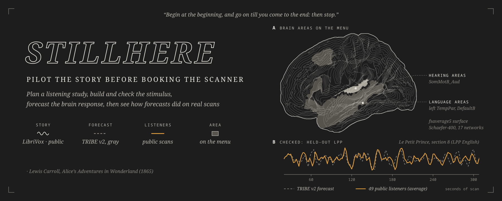
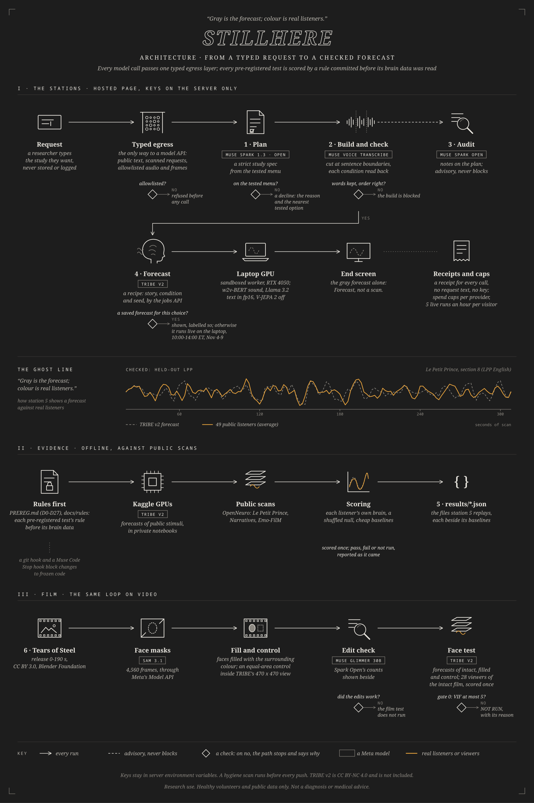

<p align="center">
  
</p>

# StillHere

### Pilot the story before booking the scanner

[](https://github.com/Yatsuiii/stillhere/actions/workflows/tests.yml)
[](LICENSE)
[](PREREG.md)
[](docs/MODEL_CARD.md)

> Labs study people who can't respond after brain injury by playing them stories in the scanner. But every new story needs its own
> 12-15 healthy volunteers scanned first, in that language. For a new story, StillHere gives labs a first reading with zero volunteer
> scans, measured against each listener's own brain. It has been tested only in healthy volunteers.

StillHere is a research tool for brain-imaging labs. It plans a listening study from a tested menu, builds and checks the stimulus
before anyone is scanned, and forecasts the healthy-adult brain response with Meta's TRIBE v2. On a held-out audiobook, the forecast
was worth **about 5 real volunteers, and at least 2** (49 listeners), and its pre-registered intact-versus-shuffled test **passed on
22 real listeners** (p = 0.00516).

**Research use. Healthy volunteers and public data only. Not a diagnosis or medical advice.**

| 12-15 | $5-15k | about 5 | p = 0.00516 |
|:---:|:---:|:---:|:---:|
| healthy volunteers scanned before a new story can be used | of scanner time per stimulus, per language | real volunteers' worth from the forecast, on a held-out audiobook (at least 2) | pre-registered pass, intact vs shuffled, 22 real listeners |

Built during the Meta Global AI Developer Hackathon (building period Oct 27 to Nov 4, 2026): Indie developer track, theme Push the
Frontier. MIT licence for our code; TRIBE v2 is CC BY-NC 4.0 and is not included.

[The problem](#the-problem) · [Results at a glance](#results-at-a-glance) · [Who it's for](#who-its-for) ·
[A worked example](#a-worked-example) · [What it does](#what-it-does) · [Results so far](#results-so-far) · [Key features](#key-features) ·
[Meta models](#meta-models-and-the-job-of-each) · [Limitations](#limitations) · [Built during the event](#built-during-the-event) ·
[Architecture](#architecture) · [Keeping our own rules](#keeping-our-own-rules) · [Quickstart](#quickstart) · [Deployment](#deployment) ·
[Project layout](#project-layout) · [Documentation](#documentation)

---

## The problem

Passive tests play a story or a film to a person in the scanner and look for the brain response a healthy listener would have. They
matter most for people who cannot answer: 1 in 4 brain-injured patients who could not follow commands at the bedside showed brain
activity on command-following tasks, on fMRI or EEG (Bodien et al., NEJM 2024; 60 of 241). That figure comes from command-following
tests, not passive listening. Passive tests with a story or a film are the other half of the toolkit (Naci et al., PNAS 2014, used a
film).

Every new story or film needs its own healthy reference first. Each story needs 12-15 volunteers: $5-15k of scanner time per
stimulus, per language, at university scanner rates of $450-700 an hour (Michigan $620, Kentucky up to $625, Yale $696), before
recruitment. So a new story, or the same story in a new language, starts with a scanner booking before anyone knows whether it will
work.

**Can a brain-response forecast give a lab its first healthy reference for a new story, before any volunteer is scanned, and how far
can it be trusted?**

**StillHere Pilot lets a lab pilot the story before booking the scanner.** A researcher types the study they want; Muse Spark 1.3
turns it into a plan from a tested menu, or declines with the reason. StillHere builds the conditions, and Muse Voice Transcribe reads
every one back before anyone is scanned. TRIBE v2 forecasts the brain response, live on a laptop. Gray is the forecast; colour is
real listeners: on a held-out audiobook, the forecast was worth about 5 real volunteers, and at least 2.

StillHere answers the second half with evidence, not a claim. Held-out forecasts are drawn against real public scans, beside cheap
baselines. Pre-registered tests are scored once, by rules committed before their brain data was read, and misses stay on the page.
So far: one held-out audiobook (about 5 real volunteers' worth, at least 2) and one pre-registered pass (Narratives notthefall); its
pre-registered secondary did not pass. The story wall and the film face test are scored once, from Sat Oct 31.

A first healthy reference for a new story, before any scans, and evidence for how far to trust it.

## Results at a glance

Not a diagnosis or medical advice.

| Test | In plain words | Number | Scope / limits | Status |
|---|---|---|---|---|
| Held-out audiobook · Le Petit Prince, section 8 · 49 listeners | TRIBE's forecast predicted each listener's language-area response about as well as averaging **5 other real listeners' scans** (at least 2). | volunteer-equivalent 5.0, lower bound 2.58; language result 1.76 z | one of TRIBE v2's own evaluation sets | Held out |
| Held-out audiobook · the Alice Datasets, chapter 1 · 22 listeners | On a different public audiobook, outside TRIBE v2's training and evaluation sets (the Alice Datasets, 22 listeners), the forecast tracked the listeners' language areas (z 1.42, p = 6e-05), but at its lower bound it was worth less than one real volunteer (about 2 at the point estimate).<br>What it had to beat: word rate and the sound envelope (beaten in 8 of 8 comparisons). | volunteer-equivalent 1.6, lower bound 0; language result 1.42 z | one chapter; the dataset's own preprocessing; 1 listener's file corrupt at the source, excluded | Exploratory · volume mapping corrected after the first run; both runs in the repository <sup>4</sup> |
| Fine-tuned TRIBE v2 · the same Alice chapter · 22 listeners | Fine-tuned TRIBE v2: On a different public audiobook, outside TRIBE v2's training and evaluation sets (the Alice Datasets, 22 listeners), the forecast tracked the listeners' language areas (z 1.40, p = 0.00015), but at its lower bound it was worth less than one real volunteer (about 1 at the point estimate).<br>Fine-tuned TRIBE v2: What it had to beat: word rate and the sound envelope (beaten in 7 of 8 comparisons). | volunteer-equivalent 1.4, lower bound 0; language result 1.40 z; fine-tuned minus stock -0.02 z, higher for 8 of 22 listeners (p = 0.59, descriptive) | our fine-tune of TRIBE v2 on LPP sections 2-7 and 9 and Narratives, never Alice; stock stays the primary model (D3) | Exploratory · rule committed Oct 31, 10:45 UTC, before any fine-tuned Alice forecast (R1) |
| Forecast variants · LPP section 1, English to develop, French to confirm | R3 (rule committed Oct 31, 10:46 UTC), the average of the stock and fine-tuned forecasts: not adopted. English, development: +0.07 z against the default. French, confirmation: +0.09 z, higher for 21 of 28 listeners, one-sided p = 0.00024.<br>R3 (rule committed Oct 31, 10:46 UTC), the stock forecast smoothed on the surface (3 passes): not adopted. English, development: +0.00 z against the default. French, confirmation: +0.01 z, higher for 20 of 28 listeners, one-sided p = 0.016.<br>Adopted for R2: none. | bar: +0.20 z and p < 0.05 on the language not used to choose (PREREG line 38) | the development section; 19 of the 28 French listeners' other sections were in the fine-tune's training targets | Exploratory · variants not adopted |
| Intact vs sentence-shuffled · Narratives notthefall · 22 listeners | TRIBE's forecast matched real listeners' language areas more closely when the story was intact than when its sentences were shuffled. | HL 0.0356 [95% CI 0.0125, 0.0588], p = 0.00516 | each version had its own TRIBE forecast; run order not public | **Pass** · pre-registered (D20, words from D27) |
| Intact vs the coarser scramble · the same story · 21 listeners | The same comparison against a coarser scramble did not pass. | HL 0.0215 [95% CI -0.0068, 0.0538], p = 0.0735; did not reach p < 0.05 | each version had its own TRIBE forecast; run order not public | Fail · the pre-registered secondary, the result of record |
| Cheap baselines · notthefall and Le Petit Prince, section 8 | On the intact-vs-shuffled test, simple stand-ins (how fast the words come, how loud the sound is) did not show the effect; TRIBE did. | p = 0.0037 for TRIBE, 0.61 for word rate, 0.93 for the sound envelope; 8 of 8 comparisons on section 8 | on the coarser scramble, word rate alone also reached p = 0.041 | Exploratory |
| Planner v2 · 62 held-out requests | Asked 62 requests it had never seen, three times each, planner v2 wrongly accepted 3 of the 132 answers that should have been declines (2.3%), under the 5% bar set before the run. | 2.3% false accepts (3 of 132; exact 95% upper bound 6.5%) | Muse Spark 1.3; Spark Open missed this bar; the live v2.1 is not re-measured | False-accept bar met; first-answer validity missed (83.3%, bar 85%) |
| Planner R4 · 62 new held-out requests | Planner R4 (rule committed Oct 31, 11:11 UTC), 62 new held-out requests, three repeats, Muse Spark 1.3: first-answer validity 100% with the new prompt against 87.1% with v2's (bar 85%). An improvement by the rule set before the run. | first-answer validity 100% vs 87.1%; decision accuracy 99.5% vs 95.2%; false accepts 0.8% vs 3.0%; decline-reason accuracy 99.2% vs 97.7%; rule-made declines 0% vs 2.2% | one prompt sentence about the analysis field, plus two clarifications, changed on development requests only and frozen before this run; plan calls only; the live v2.1 is not changed yet | Exploratory · requests committed before any prompt change |
| Stimulus check · Voice Transcribe | Our first word-shuffled control kept only 16% of the story's words; Voice Transcribe caught it before it was used. | 16% of words heard (intact 99%) | LibriVox Alice chapter 1, 75 s | Caught before scanning, not used |
| Film edit check · Tears of Steel · 62 frames per version | If the edit check fails, the film test does not run. | faces filled: no face seen in 62 of 62 (Spark Open) | controls cover 89% of face area; the 51 largest close-ups have none | Pending · Glimmer decides, Sat Oct 31 |
| Order map go/no-go · 3 LibriVox Alice clips | The order map did not pass its own rule, so it is not shown. | 1 of 3 clips (bar: 3 of 3) | forecast only, no brain data | No-go · bar set before any forecast |
| Story wall and story picker · Narratives and Le Petit Prince · 42 stories | Every story we scored stays on the wall, weak ones too. | | 41 of the 42 stories were used before the rule | Pending · pre-registered (D19), scored once from Sat Oct 31 |
| Film face test · Emo-FilM, Tears of Steel · 28 viewers | Scored once by a rule committed before any viewer's brain data was read. | | runs only if the edit check passes | Pending |
| Sedation case study · OpenNeuro ds003171 | No sedation stage line: two of the three co-primary bars did not pass. | language fell in 9 of 12 (needed 10) | a case study, not a headline | Pre-registered; exploratory variants in the [write-up](docs/writeup_sedation.md) |

<sup>4</sup> A first run used the dataset README's 10-volume offset, which the files do not follow; it is kept in
`results/alice_heldout_first_run.json`. The listener-to-listener yardstick uses the other listeners' scans as recorded, while the forecast is shifted
to each listener's own onset (0 to 0.84 s); this can lower the yardstick slightly and so raise the point estimate, but the lower bound,
z and p do not depend on it.

### Reading the results

| Term | What it means |
|---|---|
| fMRI | a brain scan that tracks blood-oxygen changes, a slow stand-in for brain activity; one brain volume every second or two |
| TRIBE v2 | Meta FAIR's model that forecasts the fMRI response of a healthy adult brain to a film, a sound or a story |
| Held out | brain data the forecast was not tuned on |
| Pre-registered | the test, its bar and its scoring code were committed before the brain data was read; scored once, pass or fail |
| "Worth about 5 real volunteers" | the forecast predicted each listener about as well as averaging 5 other real listeners' scans |
| p | how likely a difference at least this large would be if there were no real difference; our pre-registered bar is p < 0.05 |
| HL | the typical size of the difference between the two versions, with its 95% interval |
| Gray and colour | on every chart, gray dashed is TRIBE's forecast; colour is real people |

## Who it's for

| Who | What they do | What they get |
|---|---|---|
| A lab adding a new story to a listening study | types the study; Muse Spark 1.3 plans it from the tested menu | a forecast of the healthy response before booking scanner time, and the evidence for how far to trust it |
| A researcher building a control condition | builds the sentence shuffle; Muse Voice Transcribe reads it back | a control that is what it claims to be, or a blocked build (the check caught our own broken word scramble) |
| A reviewer deciding whether to trust a forecast | opens Evidence | how forecasts held up on real public scans, beside cheap baselines, misses included |

Not for: anything about one patient's scan. The planner declines it, with the reason.

## A worked example

The first story on the live menu, as the page runs it:

1. **Plan.** The researcher picks or types: *"Plan an exploratory stock TRIBE forecast for healthy English-speaking adults: The Black
   Cat, intact versus sentences shuffled, in the language network."* Muse Spark 1.3 returns the plan card:
   *"Plan (v2.1): healthy adults, English, LibriVox audiobook; conditions intact, sentences shuffled; brain areas language network;
   analysis: stock TRIBE v2 forecast."* The story card beside it lists what is in the story, each note timed and linked to the audio:
   *"The Black Cat, read by Tom Yates: one of 4 screened public stories · 1 voice heard · 6 sentences · notes: death or dying (0:43),
   alcohol or drugs (5:08), injury or illness (5:37), violence (6:04), ... Not a full review; listen before you use a story."*
2. **Build and check.** StillHere cuts the clip at sentence boundaries and shuffles the sentences; Muse Voice Transcribe reads the
   built audio back and fills the checklist (words kept, order changed). A failed check blocks the build.
3. **Audit.** Muse Spark Open reads the plan and leaves notes. Advisory: it never blocks anything.
4. **Forecast.** The laptop worker runs TRIBE v2 stage by stage (w2v-BERT for sound, Llama 3.2 for words in context) and the page
   shows each lane as it runs. It ends on the gray forecast alone: "No public scan of this clip. Forecast, not a scan."
5. **Evidence.** Below it, held-out forecasts are drawn against real listeners, beside cheap baselines, so the researcher can see how
   such forecasts held up on real scans.

## What it does

The Pilot page is a rail of six stations. Five of them call a Meta model live; Evidence replays committed results. A live station
shows its recorded run, labelled so, when live calls are off or a budget is spent.

| | Station | What happens | Meta model |
|---|---|---|---|
| 1 | **Plan** | The researcher types a study. The planner turns it into a strict study spec from a tested menu (a JSON schema built from the stimuli, controls and analyses we have evidence for), or declines with a reason code and the nearest tested option. Ask about one patient's scan, and it declines, with the reason. A request can name content notes to avoid; code, not the model, filters the menu on the story cards. | Muse Spark 1.3 (default); Muse Spark Open on Fireworks or Baseten (private mode) |
| 2 | **Build and check** | StillHere cuts the story at sentence boundaries with short crossfades. Muse Voice Transcribe reads the built audio back and fills the checklist: words kept and word order decide whether a control is what it claims to be. A failed check blocks the build. "Rebuild with the old bug" replays the broken word scramble the check caught. | Muse Voice Transcribe |
| 3 | **Audit** | Spark Open reads the plan and leaves notes. Advisory check, not measured: it never blocks anything. | Muse Spark Open |
| 4 | **Forecast** | A judge picks one of 4 screened public stories, a condition and a seed. TRIBE v2 forecasts the brain response, stage by stage, on the laptop GPU, with its Llama 3.2 text lane on (fp16). A saved forecast is shown whenever one exists for your choice. New seeds run live on the laptop, 10:00-14:00 ET, Nov 4-9. Every live run ends on the gray forecast, with no real line drawn over it. We found no public scan of the 4 screened stories; Alice chapter 1 has one (OpenNeuro ds002322), and its end line says so. | TRIBE v2 (V-JEPA 2, w2v-BERT, Llama 3.2 inside) |
| 5 | **Evidence** | Did the forecasts hold up? Each forecast against real public scans it never saw. These panels replay committed results files, each beside its cheap baselines. | TRIBE v2 |
| 6 | **Film** | The same loop on video. SAM 3.1 masked the faces in the first 190 s of Tears of Steel; StillHere filled them with the surrounding colour, and filled a same-size patch elsewhere in each frame as a control. Type "face", or another word, to make the same edit on three frames. | SAM 3.1, Muse Glimmer 30B, Muse Spark Open |

The live menu (`docs/rules/story_menu_rule.md`, exploratory; rule committed before any story was downloaded): 4 screened public
LibriVox stories, then the Alice chapters as backup. The screen runs Muse Voice Transcribe with diarization: one voice, no silence
over 5 s, and agreement with the word table TRIBE reads. Spark Open read every screened story and noted what is in it, with the line
and the time. The notes are the union of word-for-word quotes found in the transcript over 3 calls at temperature 0.6. Not a full
review; listen before you use a story.

## Results so far

Not a diagnosis or medical advice. Exploratory unless pre-registered; reported as it came. Each table names the committed file its
numbers come from.

### Forecasts against real brains

| Test | In plain words | Numbers | Status |
|---|---|---|---|
| Held-out audiobook · Le Petit Prince, section 8 · 49 listeners | TRIBE's forecast predicted each listener's language-area response about as well as averaging **5 other real listeners' scans** (at least 2). | volunteer-equivalent 5.0, lower bound 2.58; language result 1.76 z | Held out <sup>1</sup> |
| Intact vs sentence-shuffled · Narratives notthefall · 22 listeners | TRIBE's forecast matched real listeners' language areas more closely when the story was intact than when its sentences were shuffled. | HL 0.0356 [95% CI 0.0125, 0.0588], p = 0.00516 | **Pass** · pre-registered (D20, words from D27) <sup>2</sup> |
| Intact vs the coarser scramble · the same story · 21 listeners | The same comparison against a coarser scramble did not pass. | HL 0.0215 [95% CI -0.0068, 0.0538], p = 0.0735; did not reach p < 0.05 | Fail · the pre-registered secondary, the result of record |
| Story wall and story picker · Narratives and Le Petit Prince · 42 stories | Every story we scored stays on the wall, weak ones too. | | Pending · pre-registered (D19), scored once from Sat Oct 31 <sup>3</sup> |
| Film face test · Emo-FilM, Tears of Steel · 28 viewers | Scored once by a rule committed before any viewer's brain data was read. | | Pending |

<sup>1</sup> Held out; first measured Oct 22-23. LPP is one of TRIBE v2's own evaluation sets. TRIBE v2 was not trained on Le Petit
Prince or Narratives; its authors used both as held-out test sets, scored on group averages (d'Ascoli et al. 2026, Table 1). Our tests
score each listener. Emo-FilM is in neither list.<br>
<sup>2</sup> PREREG D20: "With zero same-clip controls, stock TRIBE v2's language readout was stronger when the same healthy listeners
heard a public story intact than when they heard its sentences shuffled (Narratives notthefall, 22 listeners, 9.1 minutes = 365 TRs
per version; the order of their two runs is not public)." For notthefall, each version also had its own TRIBE forecast, so a pass does
not separate a change in the listeners' brains from a change in TRIBE's forecast, and the run order is not public, so it cannot be
separated from an order or repeat-listening effect.<br>
<sup>3</sup> The story wall's scoring rule was committed Oct 28 (340b74b); 41 of the 42 stories were used before then, for development
or to tune a second model.

Files: `results/section8.json` · `results/d20_notthefall.json` · `results/story_wall.json` and `results/face_map.json` when they
land.

### Cheap baselines beside every result

On the intact-vs-shuffled test, simple stand-ins (how fast the words come, how loud the sound is) did not show the effect; TRIBE did.
Exploratory.

Every predictor is scored the same way, so TRIBE is unpartialled here (exploratory; `docs/rules/cheap_baselines_rule.md`, committed
Oct 28, before the notthefall BOLD was read). One-sided p per comparison:

| notthefall comparison | TRIBE v2 | Word rate alone | Sound envelope alone |
|---|---|---|---|
| Language areas, vs sentence-shuffled | **0.0037** | 0.61 | 0.93 |
| Language areas, vs the coarser scramble | 0.0071 | 0.041 | 0.99 |
| Hearing areas, vs sentence-shuffled | 0.9998 | 0.9958 | 0.9171 |

Against the coarser scramble, word rate alone also reached p = 0.041, so this cannot stand in for the failed secondary; p = 0.0735 is
the result of record. On Le Petit Prince, section 8, the forecast beat word rate and the sound envelope in 8 of 8 comparisons, and in
language areas it beat a simple word-rate model in 43 of 49 listeners (exploratory: that rule was written after section 8 was first
measured). Files: `results/d20_notthefall.json` · `results/section8_baselines.json`.

### Planner v2 on 62 held-out requests

Asked 62 requests it had never seen, three times each, planner v2 wrongly accepted 3 of the 132 answers that should have been
declines (2.3%), under the 5% bar set before the run.

Bars set before the run (`docs/rules/planner_v2_eval_rule.md`); a missed bar is reported as missed.

| Metric (bar) | Muse Spark 1.3 | Spark Open, Fireworks | Spark Open, Baseten |
|---|---|---|---|
| Decision accuracy (at least 90%) | 93.0% | 90.9% | 92.5% |
| False accepts (at most 5%) | **2.3%** (3 of 132; exact 95% upper bound 6.5%) | 7.6% · missed | 6.8% · missed |
| Decline-reason accuracy (at least 80%) | 99.2% | 93.4% | 95.9% |
| First-answer validity (at least 85%) | 83.3% · missed | 100% | 100% |

Spark Open on its two hosts is reported as two hosted versions, not one model. v2.1 adds clip, condition, seed and story tags; not
re-measured. File: `results/planner_v2_eval.json`.

### Planner v0 against v2, the same 62 requests

| Host | Decision accuracy, v0 → v2 | False accepts of 132, v0 → v2 |
|---|---|---|
| Muse Spark 1.3 | 32.8% → 93.0% | 18 → 3 |
| Spark Open, Fireworks | 40.9% → 90.9% | 29 → 10 |
| Spark Open, Baseten | 41.4% → 92.5% | 31 → 9 |

In v0 our fixed rules did most of the declining (107 of 114 for Spark 1.3); in v2 the model did (136 of 139). Files:
`results/planner_v0_heldout.json` · `results/planner_v2_eval.json`.

### Stimulus check: Voice Transcribe reads every condition back

Our first word-shuffled control kept only 16% of the story's words; Voice Transcribe caught it before it was used.

LibriVox *Alice's Adventures in Wonderland*, chapter 1, 75 s, before anyone is scanned:

| Condition | Words heard | In the expected order | Check |
|---|---|---|---|
| Intact | 99% | 99% | pass |
| Sentence scramble | 98% | 98% (59% in the original order) | pass |
| Word scramble, our first version | 16% | 12% | **fail: caught before scanning, not used** |
| Reversed | 0% | | played backwards, no words reach the text lane |

File: `results/conditions_manipulation_check.json`.

### Film edit check, 62 frames per version

| Version | Spark Open (Baseten) | Muse Glimmer 30B, which decides |
|---|---|---|
| Intact: a face seen | 54 of 62 | runs Sat Oct 31 |
| Faces filled: no face seen | 62 of 62 | runs Sat Oct 31 |
| Same-size control: a face seen | 51 of 62 | runs Sat Oct 31 |

The same-size control patch covers 89% of face area; the 51 largest close-ups have none. If the edit check fails, the film test does
not run. File: `results/edit_check_spark_open.json`.

### Order map go/no-go

| Clips | Language-area forecast changed more than hearing-area | Set before any forecast | Verdict |
|---|---|---|---|
| 3 LibriVox Alice clips, forecast only, no brain data | 1 of 3 | 3 of 3 | no-go: no order map is shown |

File: `results/order_map_gonogo.json`.

### Sedation case study

Frozen group statistics, with exploratory variants labelled: [docs/writeup_sedation.md](docs/writeup_sedation.md).

## Key features

- **A planner that can say no.** Muse Spark 1.3 plans from a tested menu or declines with the reason: 2.3% false accepts on 62
  unseen requests (planner v2; the live v2.1 is not re-measured).
- **Stimuli checked before anyone is scanned.** Voice Transcribe reads every condition back; it caught our own broken word scramble.
- **A live forecast on a laptop.** TRIBE v2 with its Llama 3.2 text lane, stage by stage, on a 6 GB GPU.
- **Gray is the forecast; colour is real listeners.** Held-out forecasts are drawn against real public scans, beside cheap
  baselines.
- **Rules first.** Pre-registered tests are scored once by rules committed before their brain data was read; misses stay on the page.
- **The same loop on film.** SAM 3.1 masks the faces, Glimmer decides the edit check, and the scans of 28 real viewers are the
  test.
- **Nothing private leaves.** One typed egress layer, keys on the server, receipts with no request text, a hygiene scan before every
  push.

## Meta models and the job of each

| Model | Where it runs | Its job |
|---|---|---|
| Muse Spark 1.3 | Meta Model API | The default study planner. Plans the study, or declines with the reason. |
| Muse Spark Open | Fireworks and Baseten (reported as two hosted versions, not one model) | Private planner mode, the advisory check, and the content notes on the screened stories; its edit-check counts are shown beside Glimmer's. |
| Muse Voice Transcribe | Meta Model API | Reads every built condition back before anyone is scanned, and screens the live menu's stories. |
| SAM 3.1 | Meta Model API | Masks the faces in the film, for the face edits and their equal-area controls. |
| Muse Glimmer 30B | open weights, Kaggle GPU | The deciding edit check. |
| TRIBE v2 (Meta FAIR), with V-JEPA 2, w2v-BERT and Llama 3.2 inside | laptop GPU (live) and Kaggle GPUs | Forecasts the brain response, for stories and film. |
| Muse Code | the developer's machine | Built the planner (standard model only); runs the pre-registration guard as a Stop hook. |

What we learned about them:

- A strict schema and a tested menu let the model make the decision. In Planner v0 our fixed rules did most of the declining (107 of
  114 for Spark 1.3); in v2 the model did (136 of 139 declines for Spark 1.3).
- Two hosts of the same open model are two models for evaluation: Spark Open's false-accept rate was 7.6% on Fireworks and 6.8% on
  Baseten, so each is reported on its own.
- Cheap baselines carry much of what a forecast seems to capture, so every result is shown beside them.

## Limitations

- Research use only. Healthy volunteers and public data only. Not a diagnosis or medical advice.
- Every live run is a forecast, not a scan: the end screen draws no real line.
- The held-out audiobook (Le Petit Prince, section 8) was first measured Oct 22-23, before this repository began, and LPP is one of
  TRIBE v2's own evaluation sets. The word-rate comparison is exploratory: its rule was written after section 8 was first measured.
- Intact vs sentence-shuffled: each version also had its own TRIBE forecast, so a pass does not separate a change in the listeners'
  brains from a change in TRIBE's forecast, and the run order is not public, so it cannot be separated from an order or
  repeat-listening effect. The secondary comparison did not reach p < 0.05.
- The private-mode planner (Spark Open) is over its 5% false-accept bar on both hosts; Planner v2.1 is not re-measured.
- Close-up faces leave no room for an equal-area control: the 51 largest close-ups have none, so the controls cover 88.9% of in-view
  face pixels.
- Content notes are not a full review; listen before you use a story.
- A 6 GB laptop GPU runs the live forecast, during set hours only (10:00-14:00 ET, Nov 4-9); outside them a saved forecast is shown
  when one exists.
- GPU time: if all 42 picker stories are not ready by Sun Nov 1, 18:00 UTC, the picker and the wall are reported "pre-registered, not
  run", with no partial scoring.

## Built during the event

The product repository started on 2026-10-27, inside the building period (Oct 27 to Nov 4); this public repository was cut from it
on 2026-10-28 (first commit 340b74b). Built during the event: the typed egress layer,
the Meta Model API client, the planner (v0, v2 and v2.1) and its evaluation, the Voice Transcribe checks, the live laptop forecast,
the held-out section scorer, the film edits and edit check, the face-map test, the cheap-baseline scoring, the order-map go/no-go, the
pre-registration guard and its Muse Code hook, the Pilot page and the video. Before the event: the pre-registration (Oct 21-26), the
Le Petit Prince calibration and timing harness (Oct 21-23), and the TRIBE tuning pipeline code (Oct 24-25; run Oct 26). The held-out
audiobook result was first measured Oct 22-23 and is recomputed with code built during the event; `stillhere/heldout.py`: 12 of 215
lines follow pre-event code (language-area parcel list, lag and resampling, one alignment call); the rest was written from Oct 27.

## Architecture

<p align="center">
  
</p>

- **One typed egress layer** (`stillhere/egress.py`) is the only way anything reaches a model API: public text, scanned requests,
  allowlisted public audio and film frames, three hosts (`api.meta.ai`, `api.fireworks.ai`, `inference.baseten.co`). Keys live in
  environment variables only; no response carries one.
- **Planner** (`stillhere/planner.py`, `stillhere/planner_v21.py`): Muse Spark 1.3 turns a typed request into a strict study spec, or
  declines with a reason code and the nearest supported option. Planner v2 is the version measured on 62 held-out requests and stays
  as published. In v2.1 the model only plans and our code runs the tools (list stimuli, make conditions, check conditions, forecast).
- **Manipulation check** (`stillhere/conditions.py`, `stillhere/manipulation_check.py`): Muse Voice Transcribe reads every built
  condition back; words kept and word order decide whether a control is what it claims to be.
- **Live forecast** (`worker/`, `docs/worker.md`, `docs/jobs_api.md`): stock TRIBE v2 on a laptop (RTX 4050, 6 GB GPU). The Llama
  3.2 3B text lane runs in fp16, split between the GPU and the CPU by accelerate; w2v-BERT 2.0 for sound and the brain model run on the
  CPU; V-JEPA 2 is off for audio clips. A job is a recipe and nothing else (a story from the live menu, a condition and a seed). The
  worker runs sandboxed on the laptop and pulls jobs over HTTPS; the laptop accepts no inbound connection.
- **Hosted app** (`web/`, `api/index.py`): one WSGI app on Vercel's Python runtime, standard library around the repo's own modules.
  Receipts for every live call (model, time, cost; no request text, no key), spend caps per provider, and 5 live runs an hour per
  visitor. State lives in Upstash Redis.
- **Forecasts against real brains** (`kernels/`, `stillhere/heldout.py`, `stillhere/cheap_baselines.py`): TRIBE v2 runs in private
  Kaggle GPU notebooks. Scoring compares each forecast with each real listener's own brain, against a shuffled null and against cheap
  baselines (word rate and the sound envelope; for film, brightness and motion too) that every result is shown beside.
- **Film** (`stillhere/face_edit.py`, `stillhere/face_map.py`, `web/sam.py`): SAM 3.1 tracked face masks over 4,560 frames of Tears
  of Steel through Meta's Model API, decoded with meta-sam-parser; faces filled with the surrounding colour; an equal-area control
  with the same fill inside the 470 x 470 part of the frame TRIBE's video model sees; every version checked through TRIBE's own video
  reader. Muse Glimmer 30B (open weights, on a Kaggle GPU) decides the edit check; Spark Open's counts are shown beside it.

## Keeping our own rules

- **Rules first.** Every pre-registered test's rule and scoring code is committed before any brain data it scores is read; the
  commit time is the record. A result whose rule came after its data is labelled exploratory, with when and why (`docs/rules/`,
  [PREREG.md](PREREG.md)). [PREREG.md](PREREG.md) is the frozen pre-registration
  (D0-D27). Lines it quotes in its Never lists, and lines replaced by D18 and D23, are not claims.
- **Frozen code stays frozen.** `prereg_registry.json` pins the SHA-256 of every entry point that scores a registered test. A git
  pre-commit hook and a Muse Code Stop hook (`muse-plugin/prereg-guard/`) run `stillhere/prereg_check.py` and block changes to frozen
  code. Every later plumbing change is logged with its timing in `docs/frozen_code_changes.md`, made before the relevant brain data
  was read.
- **Go/no-go before the picture.** A go/no-go written before the forecast keeps a good-looking picture honest: the order map did not
  pass its own rule, so it is not shown.
- **Captions before results.** Every caption, for every ending, was written before the result was known (`docs/captions.md`).
- **Nothing private leaves.** A pre-push hygiene scan (`scripts/hygiene_scan.py`) fails closed on keys and tokens, agent-session
  links, absolute paths that name the laptop user, subject IDs in the sedation dataset's format, em dashes and files over
  10 MB, across every file and every commit message in the history. It reads a laptop-only word list kept outside the repository and
  refuses to push without it. Binary files are listed with what built them in `docs/BINARY_PROVENANCE.md`.

## Quickstart

### 1. Install

Python 3.12.

```sh
git clone https://github.com/Yatsuiii/stillhere.git && cd stillhere
python -m venv .venv && . .venv/bin/activate
pip install -r requirements-dev.txt           # the app's runtime, pytest and scipy
git config core.hooksPath scripts/hooks      # the pre-registration guard and the pre-push hygiene scan
```

`requirements.txt` holds the hosted app's runtime dependencies, pinned to the versions it was tested with. The face edits also need
`requirements-face-edits.txt`. TRIBE v2 is not included (CC BY-NC 4.0); the live forecast runs on the laptop worker (step 5).

### 2. Run the Pilot app locally

```sh
python web/serve.py                       # http://127.0.0.1:8780/, in-memory store
STILLHERE_LIVE=0 python web/serve.py      # every station shows its recorded run
```

Live calls happen only where keys are in the environment: `MODEL_API_KEY` for Spark 1.3, Voice Transcribe and SAM 3.1;
`FIREWORKS_API_KEY` and `BASETEN_API_KEY` for Spark Open. Without them every station shows its recorded run. `web/README.md` covers
the stations, the caps and the fallbacks.

### 3. Run the tests

```sh
python -m pytest -q
python web/smoke_local.py                 # the hosted app end to end in production mode, locally
```

No test calls a model or reads a key.

### 4. Rebuild the pages and images

```sh
python scripts/build_pilot_page.py        # demo/index.html: the static, replay-only Pilot page
python scripts/build_readme_art.py        # docs/assets/: the README's hero and architecture images
```

Every number on the static page comes from a committed JSON file. The README images need nilearn, nibabel, matplotlib, scipy and
`rsvg-convert` (see the script's docstring); nothing is downloaded.

### 5. The live worker (optional, a laptop with an NVIDIA GPU)

```sh
sudo bash worker/install_worker.sh <page-url>
```

A systemd service with a dynamic user and a sandbox pulls jobs from the page over HTTPS and runs TRIBE v2 on the local GPU during the
set hours. See `docs/worker.md` and `docs/jobs_api.md`.

## Deployment

The hosted Pilot app runs on Vercel's Python runtime (`vercel.json` pins the Python framework preset; `api/index.py` is the one
entrypoint) with Upstash Redis for receipts, budgets and jobs. Git is not connected, so a push never deploys; each deploy is a
preview first, checked, then promoted. Every step, the environment variables and the smoke checks are in
[docs/deploy_checklist.md](docs/deploy_checklist.md).

**Try it:** the hosted page's address is listed here on Nov 3. Until then, open `demo/index.html` from a clone: the static,
replay-only Pilot page, no script and no network.

## Project layout

```text
api/            Vercel entrypoint: index.py exports the hosted app's WSGI callable
web/            the hosted Pilot app: stations, guard, ledger and caps, jobs API, receipts; web/public is the page
stillhere/      the library: typed egress, Meta Model API client, planner, conditions and checks, held-out scorer,
                cheap baselines, face edits and the face map, the sedation desk, the pre-registration check
worker/         the laptop worker: recipe, engine, sandboxed systemd install
kernels/        Kaggle notebook kernels (film forecasts)
scripts/        builders and runners: the static page and its media, conditions, planner evaluations, maps, the
                ghost line, the video, the README images, the hygiene scan; scripts/hooks holds the git hooks
results/        committed results files the Evidence station replays
eval/           the planner's question sets (held-out set included), the demo requests, the edit-check sample
data/           the live clips, the film stimuli's metadata, the forecast cache
assets/         public-domain LibriVox clips and the built conditions
demo/           the static, replay-only Pilot page and its media
docs/           rules, deploy checklist, jobs API, worker, captions, write-ups, binary provenance, images
replay/         the sedation desk's recorded replay
video/          the video's scene files
muse-plugin/    the pre-registration guard as a Muse Code Stop hook
tests/          the pytest suite
PREREG.md       the frozen pre-registration (D0-D27)
prereg_registry.json   SHA-256 of every entry point that scores a registered test
```

## Documentation

| Document | What it is |
|---|---|
| [PREREG.md](PREREG.md) | The frozen pre-registration (D0-D27) |
| [docs/MODEL_CARD.md](docs/MODEL_CARD.md) | The forecast card: TRIBE v2 as StillHere uses it, intended use, configuration, data, limits |
| [CITATION.cff](CITATION.cff) | How to cite this repository |
| [docs/rules/](docs/rules/) | One rule per test, each committed before its data was read: cheap baselines, the ghost-line display, the edit check, Emo-FilM, the face map, the film stimuli, Glimmer's face-edit check, the order-map go/no-go, the planner evaluations, Spark Open's face check, the story menu |
| [docs/frozen_code_changes.md](docs/frozen_code_changes.md) | Every change to frozen code, with its timing and why |
| [docs/deploy_checklist.md](docs/deploy_checklist.md) | Deploying the hosted Pilot app: accounts, environment variables, smoke checks, redeploys |
| [docs/jobs_api.md](docs/jobs_api.md) | The jobs API between the hosted page and the laptop worker |
| [docs/worker.md](docs/worker.md) | The live worker: what a job can ask for, the sandbox, the hours |
| [docs/story_menu_data.md](docs/story_menu_data.md) | The story card on PLAN and BUILD |
| [docs/captions.md](docs/captions.md) | Captions, voice-over and slides, written before the results |
| [docs/vo_script.md](docs/vo_script.md) | The video's voice-over script |
| [docs/writeup_sedation.md](docs/writeup_sedation.md) | The sedation case study: frozen group statistics |
| [docs/BINARY_PROVENANCE.md](docs/BINARY_PROVENANCE.md) | Every binary file and what built it |
| [web/README.md](web/README.md) | The hosted app: stations, caps, fallbacks, how it is built |

## What's next

- A lab's own new story, with its own listeners, intact vs shuffled, scored once by a rule written first.
- Bring the private-mode planner under its 5% false-accept bar before it is offered as a default, and measure v2.1.
- More held-out stories and films, in more languages.
- Let a lab run the forecast on its own GPU (TRIBE v2 is CC BY-NC 4.0 and is not included in the repository).

## Licences and credits

- StillHere code: MIT (see `LICENSE`). TRIBE v2 is CC BY-NC 4.0 and is not included (see `NOTICE`).
- TRIBE v2: Meta FAIR (d'Ascoli et al. 2026), weights and code released under CC BY-NC 4.0.
- SAM 3.1 (Meta): the face masks for the Tears of Steel edits come from SAM 3.1 through Meta's Model API and are decoded with
  meta-sam-parser (Meta's package, SAM License; a dependency listed in `requirements-face-edits.txt`, not included). We acknowledge
  the use of SAM in this work, as the SAM License requires.
- Data: Le Petit Prince fMRI corpus (OpenNeuro ds003643); Narratives (ds002345); Emo-FilM (ds004892, ds004872, CC0); LibriVox
  recordings (public domain); Tears of Steel and Sintel (Blender Foundation, CC BY 3.0).
- Brain surface in the README images: fsaverage5 as bundled with nilearn; areas from the Schaefer 2018 400-parcel, 17-network atlas.
- Epigraph: Lewis Carroll, *Alice's Adventures in Wonderland* (1865), public domain; its chapters are on the story menu.
